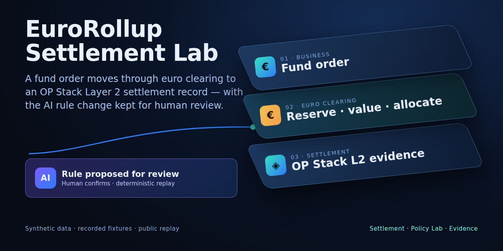
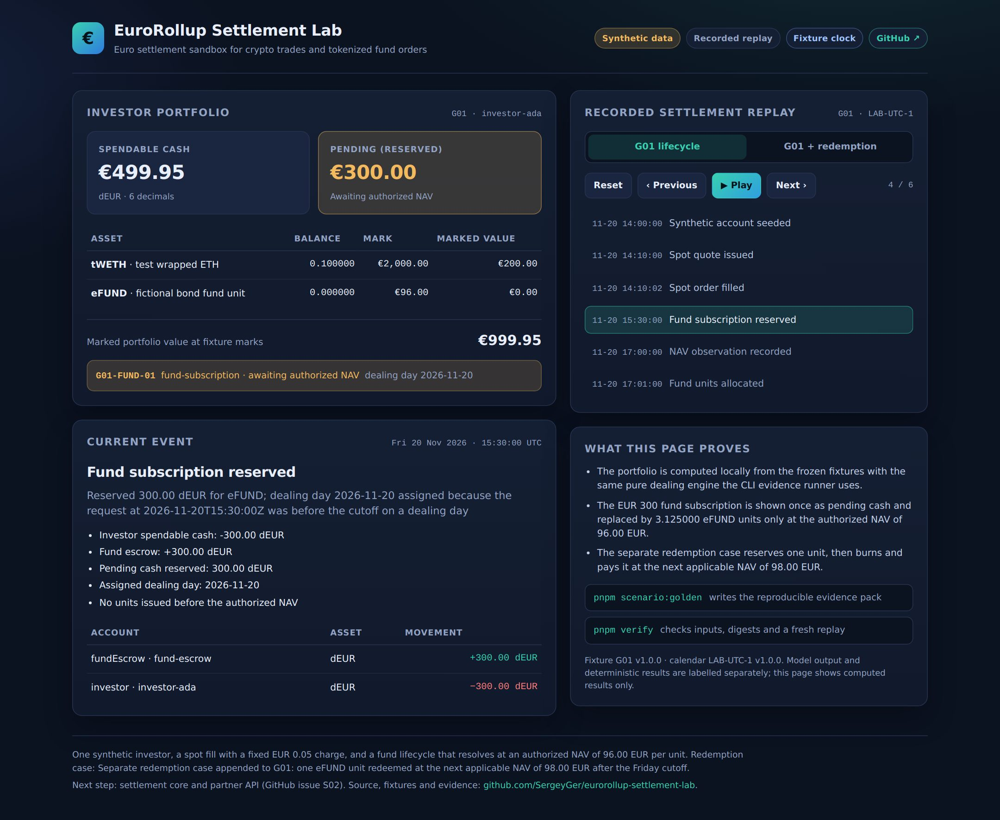
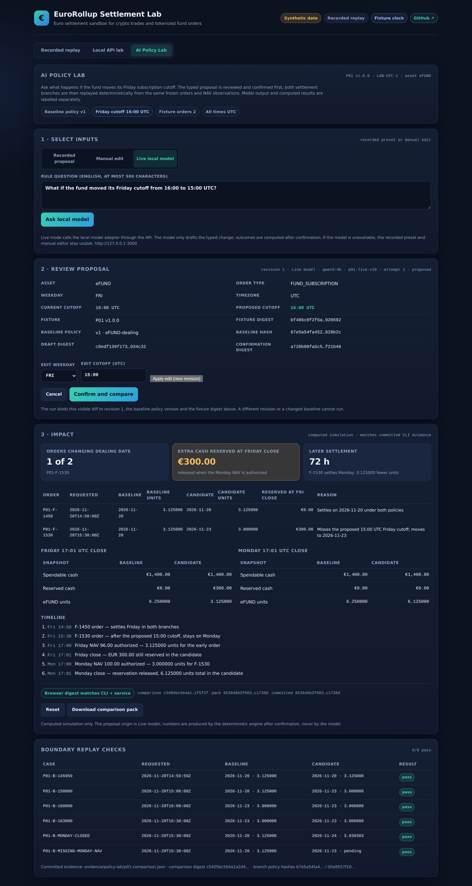

# EuroRollup Settlement Lab

An open-source euro settlement sandbox for crypto trades and tokenized fund orders — from fund order to euro clearing to onchain evidence, with an AI Policy Lab that turns a plain-English dealing-rule question into a confirmed, replayable comparison.

[Watch the 60-second film](https://github.com/SergeyGer/eurorollup-settlement-lab/releases/download/v1.1.0/eurollup-release-film-1.1.0.mp4) · [Try the live replay](https://sergeyger.github.io/eurorollup-settlement-lab/) · [Run the cutoff experiment](https://sergeyger.github.io/eurorollup-settlement-lab/) · [Verify a receipt](docs/verification/s02-settlement-core.md) · [Wiki](https://github.com/SergeyGer/eurorollup-settlement-lab/wiki)



> **Synthetic data only.** The sandbox uses invented balances, prices, instruments and identities. It moves no real funds, serves no real investors, and is not financial, legal or regulatory advice.

## Start here

- Watch the [60-second release film](https://github.com/SergeyGer/eurorollup-settlement-lab/releases/download/v1.1.0/eurollup-release-film-1.1.0.mp4) ([captions](https://github.com/SergeyGer/eurorollup-settlement-lab/releases/download/v1.1.0/release-film.vtt), [transcript](https://github.com/SergeyGer/eurorollup-settlement-lab/releases/download/v1.1.0/release-film-transcript.md)) or open the [live replay](https://sergeyger.github.io/eurorollup-settlement-lab/).
- Read the [Wiki](https://github.com/SergeyGer/eurorollup-settlement-lab/wiki) for fixtures, architecture, setup, the partner API, evidence and release history.
- Quick start: Node.js 22+, `corepack enable`, `pnpm install`, `pnpm test`, `pnpm dev`. Commands are documented in the [Wiki Development-Setup](https://github.com/SergeyGer/eurorollup-settlement-lab/wiki/Development-Setup) page and `package.json`.
- Verify the evidence with `pnpm verify --pack evidence/g01`, the release matrix with `pnpm release:checks` / `pnpm release:verify`, and the public surfaces with `pnpm check:sessions`.
- Licence: [Apache-2.0](LICENSE) and [NOTICE](NOTICE); published versions and evidence are in [Releases](https://github.com/SergeyGer/eurorollup-settlement-lab/releases) and [CHANGELOG](CHANGELOG.md).

## What the project demonstrates

A crypto purchase has filled while a fund subscription waits for its net asset
value (NAV). The sandbox explains exactly when cash becomes an asset, reserves
pending cash explicitly, and links every state change to a reproducible
receipt. The same journeys run through a typed partner API, a browser ticket and
a command-line evidence verifier.

| Journey | What a visitor can do |
| --- | --- |
| Investor portfolio | Buy or sell test wrapped ETH, subscribe or redeem fictional fund units, inspect cash reservations and policy holds. |
| Product owner workspace | Ask an English question about the weekly fund cutoff, inspect the typed rule change, confirm it and compare affected orders side by side. |
| Institutional developer | Place the same orders through the typed API, reproduce a scenario from saved policy versions, and verify the evidence pack with a command-line verifier. |
| Issuer and operator | Publish a synthetic NAV, rotate an eligibility root, diagnose a delayed batch and recover a projection, each with a defined authority and audit event. |
| Public visitor | Watch the release film, step through the recorded settlement and run the reference policy comparison in the browser. |

Model output and computed simulation results are always labelled separately:
a proposal is not an execution, and every numerical outcome is calculated by the
deterministic engine after confirmation.

## Release film and public replay

The 60-second English-narrated film is available from the replay (**Release film** view with captions off by default) and attached to the [v1.1.0 release](https://github.com/SergeyGer/eurorollup-settlement-lab/releases/tag/v1.0.0):

- [MP4 film](https://github.com/SergeyGer/eurorollup-settlement-lab/releases/download/v1.1.0/eurollup-release-film-1.1.0.mp4) · [English WebVTT captions](https://github.com/SergeyGer/eurorollup-settlement-lab/releases/download/v1.1.0/release-film.vtt) · [verbatim transcript](https://github.com/SergeyGer/eurorollup-settlement-lab/releases/download/v1.1.0/release-film-transcript.md)
- Frame, audio, caption and link checks: `media/film/film-metadata.json`; playback checks: `evidence/s14/playback-checks.json`.

The browser replay is published with GitHub Pages:
<https://sergeyger.github.io/eurorollup-settlement-lab/>. It needs no wallet, model
key or network connection: every view runs against frozen fixtures and the local API
lab is the only view that expects a running local API.

The downloadable evidence package is built with `pnpm release:package` and attached
to the GitHub Release; it contains the release-commit source, fixtures, schemas,
evidence, benchmarks and documentation with a SHA-256 MANIFEST. See
[`docs/release/README.md`](docs/release/README.md).

## Golden fixtures

The frozen fixture checkpoints, G01 and P01 tables and both calendars are documented in the [Wiki Fixtures page](https://github.com/SergeyGer/eurorollup-settlement-lab/wiki/Fixtures). Every figure is asserted by tests and reproducible from `fixtures/`.

## Replay preview

The browser replay steps through the recorded G01 settlement with the pure
dealing engine running locally. While the fund request awaits its authorized
NAV, EUR 300.00 is displayed once as pending cash and is not counted as a
holding:



See [`docs/verification/s01-foundation.md`](docs/verification/s01-foundation.md)
for the verified checkpoints, receipts and digests of the foundation step.

## Local API lab

The second view drives the local partner API through the typed SDK: create a
quote, accept an order, advance the fixture clock, publish the issuer NAV and
watch the outbox worker settle the order. While the EUR 300.00 fund request
awaits its NAV, the portfolio shows the reservation in its own bucket:


After the authorized NAV of 96.00 EUR is published, the pending cash becomes
3.125000 eFUND and the marked portfolio value stays at EUR 999.95:


API documentation: [`docs/api/partner-api.md`](docs/api/partner-api.md) and the
generated [`openapi.json`](docs/api/openapi.json). Settlement-core verification:
[`docs/verification/s02-settlement-core.md`](docs/verification/s02-settlement-core.md).

## AI Policy Lab

The third view turns an English rule question into a typed proposal, requires
confirmation, and replays both settlement branches deterministically. The Friday
cutoff experiment is computed locally from the frozen P01 fixture and checked
against the committed CLI comparison pack:


The result card reports 1 of 2 orders changing dealing date, EUR 300.00 more
reserved at Friday close and 0.125000 fewer units for the 15:30 order. The
comparison digest is identical in the browser, the service and the CLI; every
boundary replay case (14:59:59, 15:00:00, 16:00:00, closed Monday, missing NAV)
passes. Policy Lab documentation:
[`docs/policy-lab/p01-friday-cutoff.md`](docs/policy-lab/p01-friday-cutoff.md) and
verification: [`docs/verification/s03-policy-lab.md`](docs/verification/s03-policy-lab.md).

## Live local model

The Policy Lab can draft the rule change from a short English question with a
local model runtime. The model only produces the typed proposal; the deterministic
engine still computes the comparison. On release 1.0 the adapter is pinned to
`qwen3:4b` with prompt version `p01-live-v10`, temperature `0` and seed `42`.



```bash
ollama serve
ollama pull qwen3:4b
pnpm policy:model:status   # provider, pinned model, digest, prompt version
pnpm policy:eval           # 40-prompt A09 evaluation, writes evidence/policy-lab/eval.json
pnpm policy:record         # capture a genuine live proposal as the recorded preset
```

The A09 evaluation requires at least 18/20 exact valid drafts, 10/10 clarification
responses and 10/10 non-executable unsupported responses; the committed report
passes all three with every prompt recorded, including each failure. Malformed
model output is retried once with schema feedback and then rejected with a
recoverable `503`; a failed free-text request is never silently replaced by the
recorded preset, and the recorded preset and manual editor stay available.
Adapter documentation: [`docs/policy-lab/live-model-adapter.md`](docs/policy-lab/live-model-adapter.md);
verification: [`docs/verification/s04-live-model.md`](docs/verification/s04-live-model.md).

## Eligibility and euro sponsorship

Managed spot and fund dealing require current synthetic screening and issuer
class eligibility. The issuer commits wallet-bound credentials in versioned
Merkle roots, a real Noir circuit proves membership bound to wallet, chain, gate,
class, epoch and expiry, and a verified browser proof is generated locally:


The policy matrix records 19 decisions (8 allow, 4 hold, 7 decline) and 9
assertions. A basic investor's fund subscription is refused before reserving cash
(`ELIGIBILITY_REQUIRED`), a flagged persona is declined on every managed route
(`SCREENING_DECLINED`), and a root rotation between request and allocation holds
the reserved cash, mints no units and exposes `POLICY_CHANGED`. A sponsorship
limit is declined independently with `SPONSOR_LIMIT` and leaves holdings
untouched. The sponsored lane runs against the pinned ERC-4337 EntryPoint v0.7.0
with a verifying paymaster: a sponsored success, an included failure that still
costs the sponsor and an exhausted sponsor that reverts with `AA31`.

```bash
pnpm eligibility:matrix -- --check   # documented policy decisions
pnpm eligibility:verify              # circuit, verification key, proofs and vectors
pnpm aa:verify                       # committed sponsored UserOperation receipts
```

Regenerating the circuit and receipts needs the pinned toolchain
(`nargo` 1.0.0, `bb` 6.1.0, Foundry `anvil`): `pnpm eligibility:fixtures`,
`pnpm eligibility:artifacts`, `pnpm eligibility:proofs`, `pnpm aa:scenario`.
Eligibility documentation: [`docs/policy-lab/eligibility.md`](docs/policy-lab/eligibility.md);
account abstraction: [`docs/aa/account-abstraction.md`](docs/aa/account-abstraction.md);
verification: [`docs/verification/s05-eligibility-aa.md`](docs/verification/s05-eligibility-aa.md).

## Controlled rollup devnet and bridge evidence

S06 adds a reproducible local OP Stack network and a real bridge trace. The
network runs op-reth `v2.4.0` with op-node `v1.19.3`, op-batcher `v1.16.11` and
op-proposer `v1.16.3` on an anvil L1, with the full L1 contract stack deployed by
op-deployer `v0.6.0`.

```bash
pnpm devnet:local:up     # deploy and start the network
pnpm local:evidence      # capture evidence/a05/protocol-run.json and bridge-trace.json
pnpm devnet:local:down   # stop it
```

The evidence run deposits test ETH through the portal, publishes labelled L2
settlement activity as calldata batches, withdraws test ETH through the
L2StandardBridge, proves the output root against a dispute game, resolves the
game and finalizes the withdrawal through the portal. Every claim is reproducible
from the committed evidence and the launcher is deterministic.

Two limitations are recorded rather than hidden: the local L1 is execution-only,
so batches use calldata mode instead of blobs and L1 consensus finality is not
modelled; the portal's production timers are satisfied with a recorded private
`evm_increaseTime` acceleration. See [`devnet/README.md`](devnet/README.md),
[`docs/architecture/adr-01-execution.md`](docs/architecture/adr-01-execution.md)
and the verification record
[`docs/verification/s06-protocol-run.md`](docs/verification/s06-protocol-run.md).

## Economics and operations

The settlement lane is instrumented on both sides of the charge. A real two-operation
sponsored ERC-4337 bundle is measured and reconciled in wei: sponsor payment, bundler
revenue, per-operation allocation with a failed/unattributable bucket and an explicit
residual, plus an explicit 0.05 EUR investor charge leg and a timestamped demo EUR/ETH
conversion. Missing fee components are reported as unavailable, never as zero.

```bash
pnpm a07:economics    # measure the bundle and regenerate the economics evidence
pnpm a07:operations   # run the RPC, indexer, delayed-NAV and performance drills
pnpm a07:batch-drill  # batch publication pause/restore drill (requires devnet:local:up)
pnpm a07:verify       # offline verification of all A07 evidence (also in CI)
```

The operating drills cover RPC failover (independent verifier RPC, chain id and
finalized checkpoint verified, recovery inside the 60 s target), a paused-batcher
publication drill on the local OP Stack devnet, an indexer restore that refuses a
discrepant statement, and a delayed NAV that releases exactly once after a valid new
observation. `benchmarks/` publishes the drill outputs, the operating dashboard snapshot,
the weighted provider evaluation and the performance figures (200 portfolio reads and 30
real proof generations on the named local host). See
[`docs/economics/README.md`](docs/economics/README.md) and
[`docs/operations/`](docs/operations/).

## Quick start

Requirements: Node.js 22 or newer and pnpm 9 or newer
(`corepack enable` provides pnpm).

```bash
pnpm install
pnpm test              # deterministic unit, fixture and API tests
pnpm typecheck         # TypeScript project checks
pnpm scenario:golden   # replay G01 and write the evidence pack
pnpm scenario:api      # regenerate the A02 and A06 API evidence
pnpm policy:replay     # replay the P01 comparison and write its evidence pack
pnpm policy:verify     # verify the committed P01 comparison pack
pnpm policy:eval       # run the 40-prompt live-model evaluation (needs Ollama)
pnpm policy:record     # capture a genuine live-model proposal
pnpm verify --pack evidence/g01   # verify a committed evidence pack
pnpm dev               # browser: recorded replay, Local API lab and AI Policy Lab
pnpm api               # local partner API on http://127.0.0.1:3000
pnpm demo              # SDK quickstart (alias of demo:partner): G01 orders over HTTP
pnpm devnet:up         # controlled local OP Stack devnet (alias of devnet:local:up)
pnpm devnet:down       # stop the local devnet
pnpm api:openapi       # regenerate docs/api/openapi.json
```

The browser "Local API lab" view needs the API running (`pnpm api`); the
recorded replay works without a wallet, a model key or a network connection. The
[Wiki Development-Setup](https://github.com/SergeyGer/eurorollup-settlement-lab/wiki/Development-Setup)
page lists every alias and prerequisite.

See [`docs/`](docs/README.md) for architecture, fixtures, evidence formats and
the delivery plan, and the project Wiki for the reader-facing project pages.

## Repository layout

```text
apps/web             Browser replay, Local API lab and AI Policy Lab views
apps/api             Local partner API, event log, journal, outbox worker and scenario service
packages/dealing     Pure deterministic dealing engine shared by browser, CLI and worker
packages/policy-lab  Proposal schema, draft revisions and two-branch replay (shared by browser, API and CLI)
packages/sdk         Typed partner SDK and HTTP client
packages/economics   Deterministic A07 economics: reconciliation, cost experiment, funding guard
contracts           Foundry contracts (spot router, fund vault, share token)
circuits            Noir eligibility circuit and vectors
devnet              Controlled local OP Stack devnet launcher and docs
fixtures            Frozen synthetic inputs (G01, P01, calendars, instruments)
schemas             Versioned JSON Schemas for receipts, journals and evidence packs
evidence            Committed evidence packs for released gates (including REL checks)
benchmarks          A07 economics and operations drill evidence
media               Release film metadata, captions, transcript and card designs
docs                Architecture, fixtures, plan, ADRs and verification notes
```

## Delivery status and roadmap

The project is delivered in documented steps tracked as GitHub Issues and
Milestones. Each step closes only when its fixtures, tests and evidence are
merged, and larger steps are tagged as GitHub Releases.

- `v0.1.0` — foundation: frozen fixtures, integer money arithmetic, versioned UTC
  calendar, the G01 portfolio replay with a reproducible evidence pack.
- `v0.2.0` — settlement core: local partner API, durable event log and outbox,
  idempotent orders, cancellation windows, typed SDK, browser Local API lab and
  the A02/A06 evidence.
- `v0.3.0` — AI Policy Lab: typed proposal schema, revisioned drafts with
  confirmation binding, deterministic P01 two-branch comparison, scenario API,
  browser Policy Lab view and the A09 deterministic evidence pack.
- `v0.4.0` — live local model adapter: pinned `qwen3:4b`, prompt version
  `p01-live-v10`, the 40-prompt evaluation and a genuine recorded live capture.
- `v0.5.0` — eligibility and sponsorship: real Noir membership circuit, three
  personas and policy matrix, browser proving, sponsored account lane against the
  pinned ERC-4337 EntryPoint and A04 receipts.
- `v0.6.0` — controlled rollup devnet and bridge withdrawal: reproducible local
  OP Stack, calldata batch publication linked to the L2 safe head, canonical
  withdrawal proven and finalized on the portal, ADR-01 to ADR-04 and the A05
  evidence packs (blob DA remains an open gap).
- `v0.7.0` — economics and operations: measured bundle reconciliation, interactive
  browser cost experiment, funding guard, RPC failover, batch publication, indexer
  restore and delayed-NAV drills, operating dashboard, provider evaluation and
  performance publication.
- `v0.8.0` — verification and release candidate: the complete A01–A09 gate matrix,
  an offline release-check verifier, recorded limitations for the A05 chain lane and
  a release-candidate decision at `evidence/release-checks.json`.
- `v0.9.0` — public release: GitHub Pages replay, unauthenticated public checks in a
  clean browser, public link checks, downloadable release package with a SHA-256
  manifest and the A08 public-release record.
- `v1.0.0` — final release: the required 60-second English-narrated film with WebVTT
  captions, transcript, frame/audio/link checks and the completed A01–A09 matrix;
  downloadable package and public replay. Final `A08` gate passes on the tagged
  commit.

See the development roadmap in the GitHub Issues and
[`docs/plan/roadmap.md`](docs/plan/roadmap.md). API surface:
[`docs/api/partner-api.md`](docs/api/partner-api.md).

## Security

The sandbox is synthetic and local-first. Local credentials are never committed:
the maintainer's GitHub token lives in an ignored `.git-token` file. Dependency
alerts, secret scanning, push protection and branch protection are enabled on
the repository. Please report vulnerabilities according to
[`SECURITY.md`](SECURITY.md).

## License

Apache License 2.0 — see [`LICENSE`](LICENSE) and [`NOTICE`](NOTICE).
