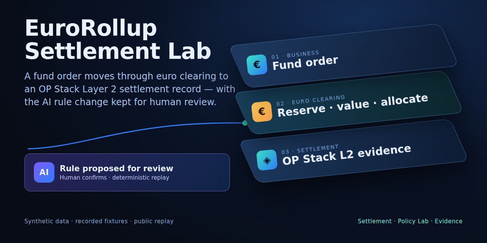

# Public release

The public replay is served from GitHub Pages and the downloadable evidence package
is attached to the GitHub Release.

## Public replay

<https://sergeyger.github.io/eurorollup-settlement-lab/>

The replay is a static build of the browser application. It needs no wallet, model
key or API: the recorded settlement, the Policy Lab comparison, the eligibility
policy matrix, the sponsored account receipts and the economics/operations views
run against frozen fixtures. The local API lab is the only view that expects a
running local API.

The Pages workflow (`.github/workflows/pages.yml`) builds the web app with the
project-site base path and deploys `apps/web/dist` on every push to `main`.

## Release film

The required 60-second English-narrated film is available in the replay **Release film**
view and attached to the GitHub Release as `eurollup-release-film-1.1.0.mp4`. Captions (`media/film/release-film.vtt`, a separate track that starts off),
the verbatim transcript (`media/film/release-film-transcript.md`) and the frame/audio
check record (`media/film/film-metadata.json`) are published with checksums.

The film records both journeys from the release build: the G01 portfolio spot fill and
fund lifecycle, then the Policy Lab P01 comparison with a genuine live-model proposal.
The opening 150 frames show the social preview, the closing 150 frames show the
repository card with the canonical URL, and the middle 1500 frames show the journeys.
See [`../verification/s10-release-film.md`](../verification/s10-release-film.md).

## Release attestation

`evidence/release-attestation.json` records the v1.0.0 tag commit, the build commit, the
four evidence/metadata files that differ between them and the archive/film digests;
`evidence/release-attestation-v1.1.0.json` records the same relationship for the
presentation release (`v1.1.0` over build commit `3af773e`). The
archive is explicitly marked `exactTaggedTree: false` because it was built from the
release-code commit, not from the tagged tree. Verify with
`pnpm release:attest:verify` (also run in CI).

## Downloadable package

`pnpm release:package` builds a deterministic source archive of the release commit
with a `MANIFEST.json` that lists SHA-256 and byte size for every file. The builder
re-extracts the archive and verifies every manifest entry before writing
`evidence/a08/release-package.json`. The archive is attached to the GitHub Release.

## Public verification (A08)

`pnpm a08:public-check` performs the A08 public-release checks without
authentication:

1. fetches the public replay URL (HTTP status and content markers);
2. opens every browser view in a clean Playwright context, captures console/page
   errors and screenshots;
3. runs representative documented quickstart commands;
4. tests the public links (repository, wiki, releases);
5. extracts and verifies the downloadable package against its manifest.

The result is `evidence/a08/public-release.json`, verified offline by
`pnpm a08:verify` (also part of the release-check matrix). A08 stays pending until
the S10 film exists; the public parts are recorded as passed in the meantime.

## Final release

`v0.9.0` is the public replay and release-packaging step. The final `v1.0.0`
requires A08 on its commit, including the film frame and narration checks.
