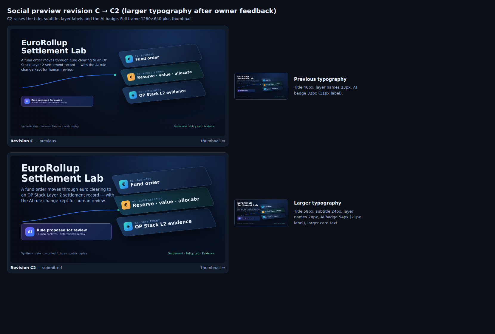

# Social preview redesign — candidate revisions

Owner approval gate for audit-brief item ART-01 (#46). The GitHub Social Preview and all
downstream artwork (README poster, Wiki film page, film opening shot) must use the
explicitly approved revision.

## Design brief

- Show how a fund order moves through euro clearing and settlement on an OP Stack Layer 2
  blockchain.
- Use a few familiar visual elements so the link between traditional finance and the
  onchain settlement record is easy to recognize.
- Show the AI agent proposing a financial rule for human review.
- Contemporary style that reads clearly at thumbnail size.
- Text limited to the project name and one short supporting line.
- No specific amounts, asset prices or fine print.
- Deliverable format: 1280 x 640 PNG plus a thumbnail.

## Candidate revisions

| Revision | Concept | Status |
| --- | --- | --- |
| A | Settlement flow: fund-order card, euro-clearing card and OP Stack L2 evidence card joined by arrows, with an AI rule-review card and a human-approval badge. | available |
| B | Split ledger: traditional euro-clearing ledger on a light half, onchain batch record on a dark half, euro medallion at the seam, AI review card. | available |
| C | Isometric stack: three settlement layers (business, euro clearing, settlement evidence), flow arrow and an AI review callout. | owner chose this direction; superseded by C2 |
| C2 | Revision of C after owner feedback: larger typography throughout, especially the AI badge and its card. | **submitted for approval** |

Owner feedback on revision C: approve the direction and increase the fonts, especially for
the AI element. C2 implements that feedback and is the revision awaiting approval.

## Files and digests

| File | Bytes | SHA-256 |
| --- | --- | --- |
| `rev-a-1280x640.png` | 355611 | `b4150c1767b043834bf797dc99c84eb1b68b4ea75623678aa8654bcaaf55d20e` |
| `rev-a-thumb-320x160.png` | 49696 | `6f4c111ee5d2e6d256cb3c23039ba84b84040d5a0c0ced4f16f99a8bf509c001` |
| `rev-b-1280x640.png` | 423819 | `c605145778d4bbd52e98e3a909e9aa5a06ec1825656fd4405e2e4daa7c56c377` |
| `rev-b-thumb-320x160.png` | 40259 | `7e8a19dc8e1c18db8550ec4f4a8d6a1cea0b3f4baa96e1b77134b943ccc48bbb` |
| `rev-c-1280x640.png` | 444462 | `527cb6d4d5731963e5832b98dfe45bc6ddb4f7d3bb6e126f39c415b1deec93af` |
| `rev-c-thumb-320x160.png` | 52382 | `bc854a677fc79f73b2a0c2b882ca58f8b32b979af2264ffc433762e046d9000e` |
| `rev-c2-1280x640.png` | 475150 | `1b56f8f964dfea2363a8376ba6a668bc0c888880b15595defcc5e89a5bf4164e` |
| `rev-c2-thumb-320x160.png` | 60301 | `e1411358b72c134e51ae91c06e9bd6d20c3d470faf00640c549a7d488bfd20be` |
| `contact-sheet-1640x1180.png` | 426293 | `f0d2ca0fd213f994a2da38c0b49b6e1fa35d03e9cd64f6fd504c4ffc5144e729` |
| `contact-sheet-c2-1660x1120.png` | 445868 | `d3c1f0e4f61234f665f34d92226162f66f6699b2b5eefdf21769a993707c60b9` |

## Owner approval

| Revision | Status |
| --- | --- |
| A | available |
| B | available |
| C | owner chose the C direction; typography feedback recorded |
| C2 | awaiting owner decision |

Approval is recorded in issue #46. Integration into the README, Wiki and film starts only
after the accepted revision and its digest are recorded; requested changes are applied as
a new revision with a new digest.
